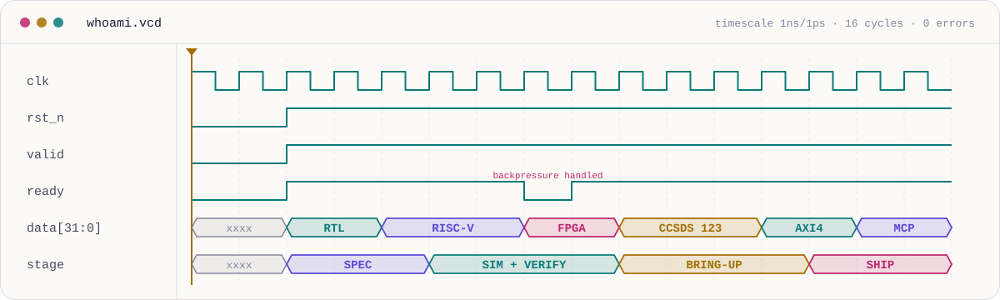
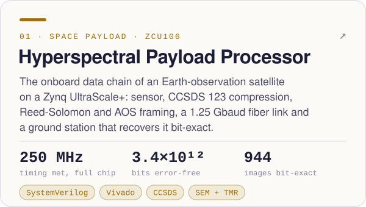
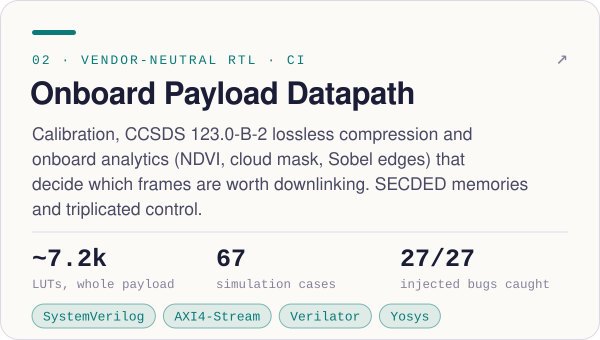
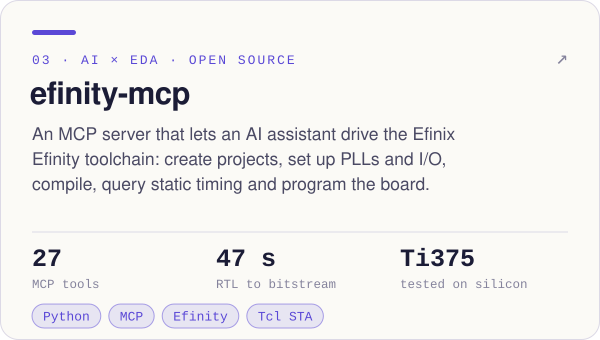
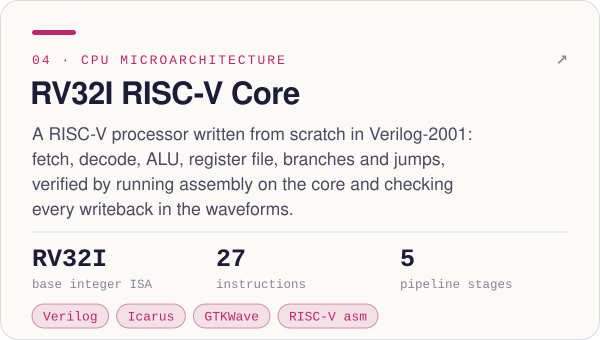
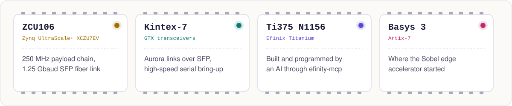
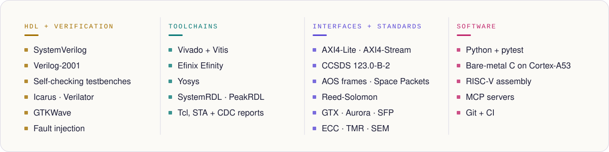

<a href="https://shubhamdraveriya.github.io/website/">
  <picture>
    <source media="(prefers-color-scheme: dark)" srcset="assets/header-dark.svg">
    
  </picture>
</a>

<p align="center">
  <a href="https://shubhamdraveriya.github.io/website/"></a>
  <a href="https://www.linkedin.com/in/shubham-draveriya"></a>
  <a href="https://drive.google.com/file/d/1e9Pp6eI2Jy77L3aIGjsXdL-Me41j0Ima/view?usp=drive_link"></a>
  
</p>

## `$ whoami`

I write RTL, debug it waveform by waveform, and bring it up on real boards. Lately that means
a satellite's onboard data chain on a Zynq UltraScale+: hyperspectral samples go in, get
compressed to the CCSDS 123 standard, framed and Reed-Solomon coded, shot down a fiber link,
and come out the other side **bit-exact**.

The part I enjoy most is bring-up: running code on a core I built, staring at the trace until
the bug gives itself away, then fixing it for real.

```systemverilog
module shubham_draveriya (
  input  logic clk,                 // 250 MHz, every rising edge counts
  input  spec_t spec,
  output silicon_t silicon          // CDC clean, bit-exact
);
  always_ff @(posedge clk)
    silicon <= bring_up(verify(rtl(spec)));
endmodule
```

<picture>
  <source media="(prefers-color-scheme: dark)" srcset="assets/whoami-dark.svg">
  
</picture>

## Featured silicon

<p align="center">
  <a href="https://github.com/shubhamdraveriya/Hyperspectral-Payload-Processor"><picture>
    <source media="(prefers-color-scheme: dark)" srcset="assets/card-hpdp-dark.svg">
    
  </picture></a>
  <a href="https://github.com/shubhamdraveriya/Image-Processing-Accelerator-for-Edge-Detection"><picture>
    <source media="(prefers-color-scheme: dark)" srcset="assets/card-payload-dark.svg">
    
  </picture></a>
  <a href="https://github.com/shubhamdraveriya/efinity-mcp"><picture>
    <source media="(prefers-color-scheme: dark)" srcset="assets/card-efinity-dark.svg">
    
  </picture></a>
  <a href="https://github.com/shubhamdraveriya/RISC-V"><picture>
    <source media="(prefers-color-scheme: dark)" srcset="assets/card-riscv-dark.svg">
    
  </picture></a>
</p>

<details>
<summary><b>What's behind the HPDP numbers</b></summary>
<br>

| Milestone | What was proven, on the board |
|---|---|
| CCSDS 123 compressor | bit-exact on all 864 configurations of the test matrix; 250 MHz at 13.6k LUTs |
| Reference models | byte-identical with an independent CCSDS 123.0-B-2 implementation (NTNU) on 944 images |
| Optical downlink | PRBS-31, 3.4 × 10¹² bits error-free over OM3 fiber at 1.25 Gbaud |
| Error correction | scenes recovered bit-exact at a channel BER of 0, 10⁻⁴ and 10⁻³ |
| Sustained rate | 76.8 Msamples/s for 10 minutes without a dropped line |
| Radiation mitigation | SEM scrubbing corrects upsets in ≤ 153 ms; ECC, TMR, watchdogs; no silent corruption in protected state |

Full report in [the repository](https://github.com/shubhamdraveriya/Hyperspectral-Payload-Processor).

</details>

## On the bench

<picture>
  <source media="(prefers-color-scheme: dark)" srcset="assets/bench-dark.svg">
  
</picture>

## The lab stack

<picture>
  <source media="(prefers-color-scheme: dark)" srcset="assets/stack-dark.svg">
  
</picture>

## Right now

- 🛰️ **HPDP**: milestones M0–M7 are done and board-tested, including the `NX_MAX` 1024 build and runs on real hyperspectral data.
- 🤖 **efinity-mcp**: v0.1.0 is out. It is tested on Windows; if you run Efinity on Linux, I'd like to hear how it goes.
- 🔍 **Looking for**: internships, full-time roles and collaborations in RTL design, verification and FPGA bring-up.

## Let's talk

Hiring for RTL, verification or bring-up work, or building something with FPGAs in it?
Find me on [LinkedIn](https://www.linkedin.com/in/shubham-draveriya), grab my
[resume](https://drive.google.com/file/d/1e9Pp6eI2Jy77L3aIGjsXdL-Me41j0Ima/view?usp=drive_link),
or take [the chip apart on my website](https://shubhamdraveriya.github.io/website/).

<p align="center"><sub><code>$finish;</code> · artwork is hand-written SVG from <a href="assets/generate.py"><code>assets/generate.py</code></a> and follows your light or dark theme</sub></p>
