<picture>
  <source media="(prefers-color-scheme: dark)" srcset="assets/figure-dark.svg">
  
</picture>

*Figure 1. The satellite data chain I built on a ZCU106. The sensor produces more data than the
fiber can carry, so the FPGA compresses it without losing a single bit: about 3 to 1 on real
AVIRIS scenes, and all 49 of them decode back exactly.*

I write RTL in Verilog and SystemVerilog and bring it up on real boards. I like hardware that
has to work the first time, and the part I enjoy most is bring-up: running code on something I
designed, reading waveforms until the bug gives itself away, then fixing it properly.

## Things I've built

**[Hyperspectral Payload Processor](https://github.com/shubhamdraveriya/Hyperspectral-Payload-Processor)** 
The chain in Figure 1, from a sensor emulator to a ground station on a PC. It meets 250 MHz on a
Zynq UltraScale+, sent 3.4 × 10¹² bits over the fiber without an error, and matches an
independent CCSDS 123 implementation on 944 images. Radiation upsets are scrubbed within
153 ms, and a fault-injection campaign found no silent corruption in protected state.

**[Onboard payload datapath](https://github.com/shubhamdraveriya/Image-Processing-Accelerator-for-Edge-Detection)** 
This started as a Sobel edge detector on a Basys 3 and grew into a vendor-neutral payload in
SystemVerilog. Beyond compression, it computes NDVI and a cloud mask on board, so cloudy frames
don't waste downlink time. I broke it on purpose 27 times, and the testbenches caught every one.

**[efinity-mcp](https://github.com/shubhamdraveriya/efinity-mcp)** 
An MCP server that lets an AI assistant drive the Efinix Efinity toolchain: set up pins and
PLLs, compile, read timing reports and program the board. Its first real job was an LED demo on
a Ti375 dev kit, which went from a one-line request to timing-clean silicon.

**[RV32I core](https://github.com/shubhamdraveriya/RISC-V)** 
My first CPU: a RISC-V core written from scratch in Verilog, tested by running assembly on it
and checking every writeback in GTKWave.

## What I work with

Vivado and Vitis, Efinity, Icarus and Verilator, GTKWave, Yosys, and Python with pytest for
reference models. Boards I've brought up: a ZCU106, a Kintex-7 with GTX transceivers and Aurora
over SFP, an Efinix Ti375 and a Basys 3.

## Get in touch

I'm looking for RTL, verification and FPGA roles. [LinkedIn](https://www.linkedin.com/in/shubham-draveriya)
is the quickest way to reach me. My [resume](https://drive.google.com/file/d/1e9Pp6eI2Jy77L3aIGjsXdL-Me41j0Ima/view?usp=drive_link)
has the details, and [my website](https://shubhamdraveriya.github.io/website/) takes a chip
apart as you scroll.

<!-- Figure 1 is drawn by assets/generate.py. -->
